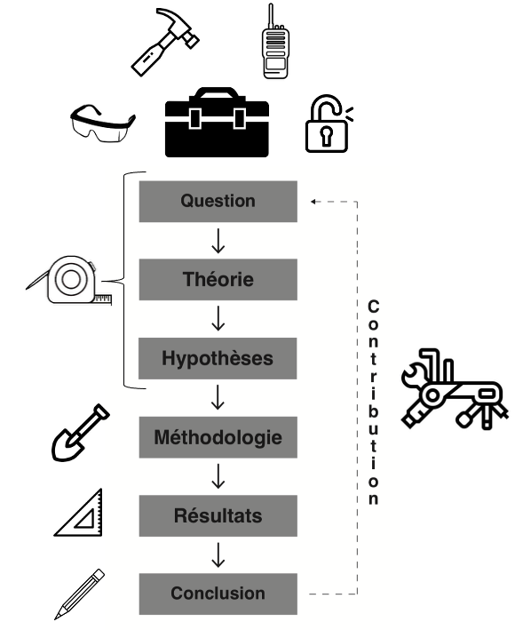

## 1. Point d'observation : l'essor des CAQDAS libres

:::: {.columns}

::: {.column width="65%"}
- **Origine :** Développé à partir de 2018 par Rémi Rampin, Vicky Steeves et Sarah Appelt pour combler l'absence d'alternatives libres aux logiciels propriétaires coûteux (*NVivo*, *MAXQDA*).
- **Évolution :** D'un simple script local à une application web multiplateforme (Windows, macOS, Linux) utilisable en local ou sur serveur collaboratif en temps réel.
- **Cycle de la recherche :** S'inscrit aux étapes **Méthodologie** (codage et traitement du corpus) et **Résultats** (extraction des faits saillants).
:::

::: {.column width="35%"}
{.schema-cycle fig-align="center"}
:::

::::

## 2. 6 critères de sélection d'un outil 

| Critères | Taguette | NVivo | MAXQDA |
| :--- | :--- | :--- | :--- |
| **Accessibilité** | Gratuit, multiplateforme + version web | Coûteux (licences institutionnelles) | Coûteux (licences étudiantes ou annuelles) |
| **Communauté** | Active (surtout recherche ouverte) | Très vaste (standard académique) | Très vaste (forte présence en Europe et sciences sociales) |
| **Popularité** | Croissante (petits projets, mémoires) | Dominante en sciences sociales | Très populaire (méthodes mixtes) |
| **Compatibilité** | Import : PDF, DOCX, TXT / Export : CSV, HTML, DOCX | Très large (audio, vidéo, réseaux sociaux, SPSS) | Très large (multimédia, données d'enquête, R, SPSS) |
| **Transparence** | Code source ouvert (licence BSD-3) | Faible (logiciel propriétaire fermé) | Faible (logiciel propriétaire fermé) |
| **Adaptabilité** | Faible (codage textuel pur uniquement) | Très élevée (requêtes complexes, matrices) | Très élevée (outils visuels, analyses mixtes quali-quanti) |

## Démonstration pratique {.center .slide-demo background-color="#6B1D1D"}

## Choix éditorial

::: {.choix-editorial}
**Choix éditorial :** Taguette est recommandé pour les corpus textuels de taille petite à moyenne et le travail d'équipe sans budget, mais il est insuffisant pour les analyses multimédias ou les méthodes mixtes complexes offertes par NVivo et MAXQDA.
:::

::: {.positif}
**Positif :** Gratuit, simple à utiliser, exportation variée (DOCX, PDF, HTML, CSV, etc.).
:::

::: {.limites}
**Limites :** Le copier-coller de texte donne parfois une mauvaise vue d'ensemble. Les titres ont un nombre maximal de caractères. 
Principalement conçu pour annoter des fichiers téléchargeables (peu adapté aux articles de journaux en ligne ou aux plateformes électorales). = Taguette ne prend en charge que les fichiers textuels
:::

## Sources et références

::: {.sources-box}
* **Rampin, R., & Rampin, V. (2021).** Taguette: open-source qualitative data analysis. *Journal of Open Source Software*, 6(68), 3522. [https://doi.org/10.21105/joss.03522](https://doi.org/10.21105/joss.03522)
* **Site officiel et documentation de Taguette :** [https://www.taguette.org](https://www.taguette.org)
* **Dépôt du code source (GitLab) :** [https://gitlab.com/remram44/taguette](https://gitlab.com/remram44/taguette)
* **Documentation comparative :** Lumivero (*NVivo*) et VERBI Software (*MAXQDA*), consultées en novembre 2026.
:::

